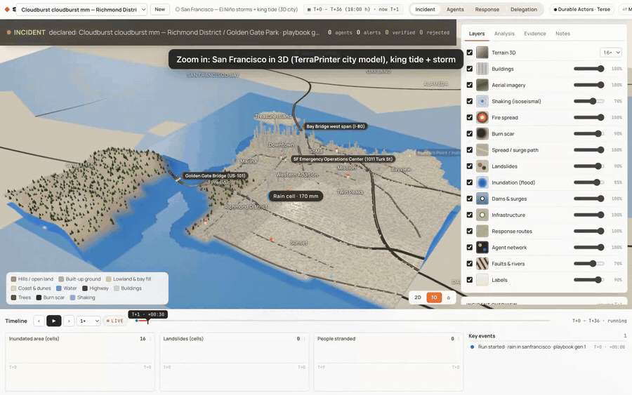
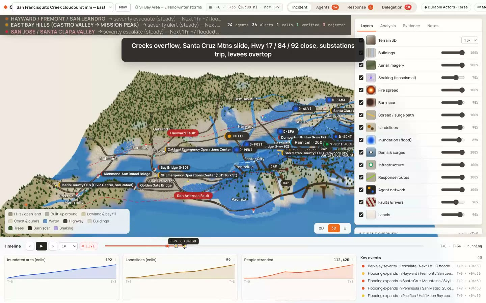
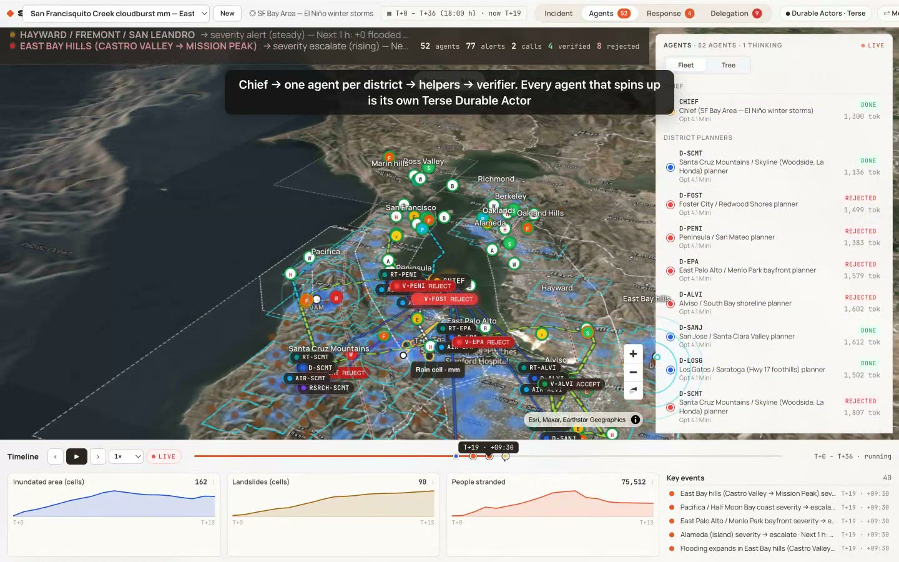
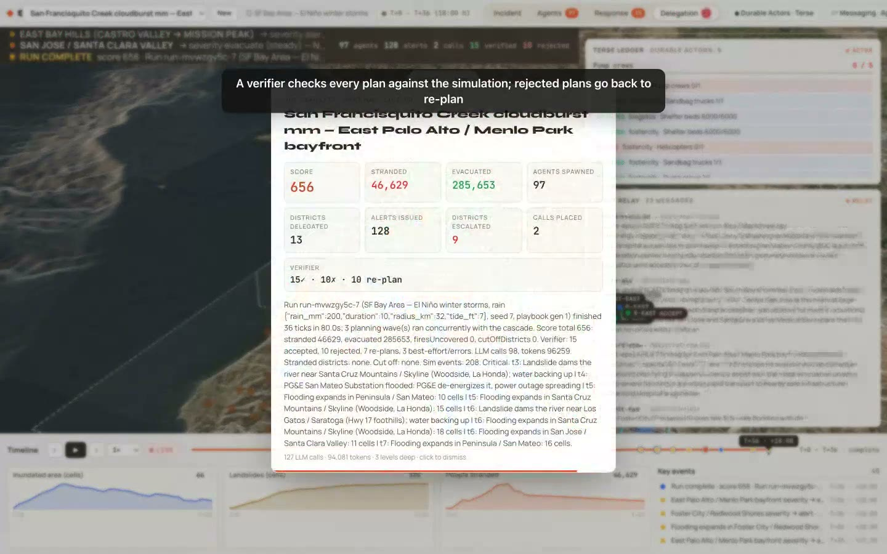
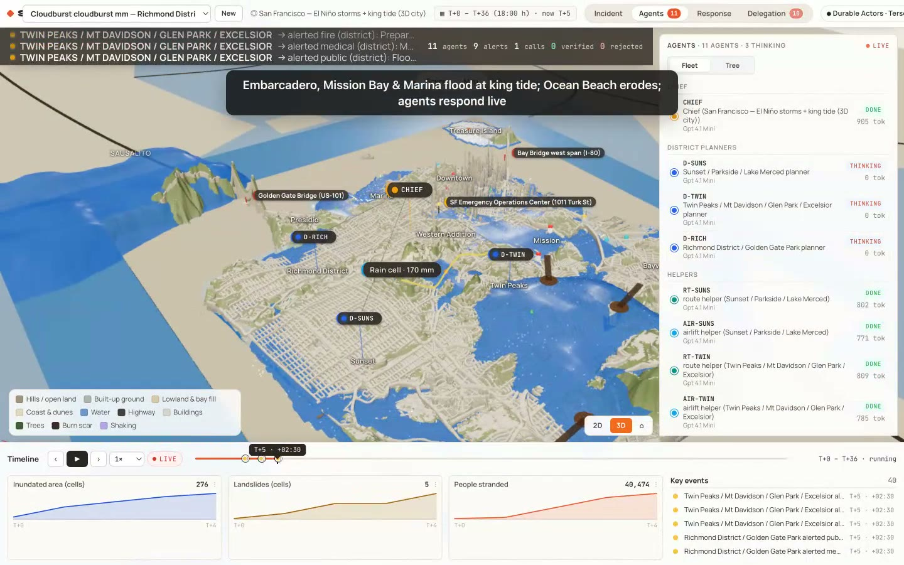
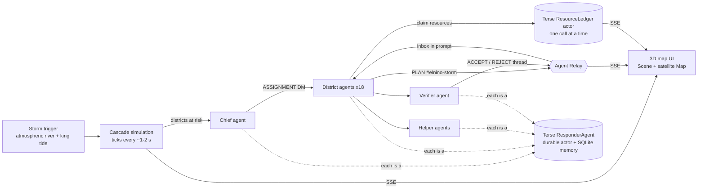

<div align="center">

# 🌊 SUPERSCADE: El Niño Preparedness Agents

### An AI emergency team that rehearses El Niño floods and landslides in real time, so Bay Area cities find the gaps in their plan *before* the storm hits.

**Haunted Hacks: Real-Time AI Edition** · Y Combinator · Oct 31 2026 · Tracks: **Terse** + **Agent Relay**



</div>

---

## The problem
When El Niño hits, the disasters arrive together:
- **1982:** one storm set off thousands of landslides.
- **1998:** San Francisquito Creek flooded about 1,700 properties.
- **2017:** Coyote Creek forced about 14,000 evacuations in San Jose.

Every city then competes for the **same few helicopters, swift-water teams and shelter beds**. Plans are written county by county, but nobody rehearses that fight.

## What SUPERSCADE does
1. **Trigger:** you start an **atmospheric river and a king tide**.
2. **Cascade:** a simulation sets off creek floods, Santa Cruz Mountains debris flows, Pacifica bluff collapse, closures on Hwy 17, 84, 92 and Devil's Slide, tripped substations, overwhelmed pump stations and overtopped levees.
3. **Response:** a team of AI agents **spins up live to respond**:
   - a **chief** triages the districts at risk,
   - one **district agent** per city plans its response,
   - **helpers** handle routing, shelter and airlift,
   - a **verifier** rejects unsafe plans until they're re-planned.

The simulation **never waits for the AI**. Slow plans cost people.

| | |
|---|---|
|  |  |
| **The storm cascade** on 3D Bay Area terrain: 18 districts, 8 creeks, 12 highways, 69 facilities | **The agents** on the satellite map: chief, 18 district agents, helpers and verifiers |
|  |  |
| **The Terse ledger and the Agent Relay feed**, live side by side | **San Francisco in 3D** (TerraPrinter city model): the king tide floods the Embarcadero and Mission Bay |

## How we use the sponsor tech

### ⬢ Terse: every agent is a Durable Actor
- **One actor per agent.** Every agent that spins up gets its own `ResponderAgent` durable actor (actor id = agent id). It has `@Persisted @Emittable` role and status, plus its **own SQLite memory**: what it was assigned, what it read on Relay, what it planned, and what the verifier said.
- **A ledger actor per incident.** A **`ResourceLedger` actor** owns the scarce resources: swift-water teams, helicopters, pump crews, sandbag trucks and shelter beds.
- **Why Terse matters here:** a Terse actor runs **one call at a time**, so when 10 district agents claim at once, **no helicopter is ever double-booked**. A denied claim is written into the plan and forces a re-plan, and a rejected plan releases its claims.

### ⇄ Agent Relay: the agents' radio
Every agent is an Agent Relay participant on `#elnino-storm`:
- **TRIAGE:** the chief posts which districts are at risk.
- **ASSIGNMENT:** the chief DMs each district agent its job.
- **PLAN:** district agents post their plan plus their Terse claims.
- **FINDINGS:** helpers DM their district agent.
- **ACCEPT / REJECT:** the verifier replies **in the plan's thread**.

**The coordination itself runs through Relay.** Each district agent's Relay inbox (its DM plus what other districts already claimed) goes into its LLM prompt before it plans.

### Measured on one live run (Bay Area, seed 7)
| Durable actors booted | Ledger claims (incl. denials) | Relay messages | Verifier verdicts | LLM latency |
|---|---|---|---|---|
| **67** | **81** | **53** | **18** | **1–4 s per call** (OpenAI gpt-4.1-mini) |

## Architecture


## How it maps to the judging criteria
| Criterion | Where to look |
|---|---|
| **Real-time AI + track tech** | The agents plan while the simulation keeps ticking. Risk is re-assessed every tick, and when a district's forecast rises, its agent is re-dispatched. Terse runs 1 actor per agent plus the ledger; Agent Relay carries DMs, the channel and threads, and the Relay inbox feeds each prompt. |
| **Originality** | A disaster "fire drill" for AI agents. The hard part of El Niño is **contention for shared resources** across cities, and Terse's single-threaded actors model exactly that. |
| **Execution** | It runs end to end with live OpenAI. The verifier runs deterministic checks plus an LLM review, rejected plans are re-planned, and there are 3 regions (Bay Area, San Francisco, Nepal). |
| **UX and design** | 3D terrain, a satellite map, facility markers, an agent tree, the Terse ledger card, the Relay feed and a timeline scrubber. |
| **Impact** | County OES teams could rehearse El Niño, king-tide and atmospheric-river seasons and see which districts get stranded when the resources run out. |

## For AI reviewers: verify the claims in code
| Claim | File |
|---|---|
| `ResponderAgent` durable actor: SQLite memory, `boot`, `remember` | [`actors/src/actor.ts`](actors/src/actor.ts) (L10–L75) |
| `ResourceLedger` actor: one-at-a-time `claim` and `release` | [`actors/src/actor.ts`](actors/src/actor.ts) (L76–L120) |
| Node wrapper that calls the Terse actors (timeouts, graceful fallback) | [`server/infra/terse.ts`](server/infra/terse.ts) |
| Relay workspace, standing agent identities, `relaySend`, `relayReply` (threads), `relayInbox` | [`server/infra/relay.ts`](server/infra/relay.ts) |
| Chief TRIAGE post and ASSIGNMENT DMs | [`server/agents/orchestrator.ts`](server/agents/orchestrator.ts) (~L119) |
| Relay inbox injected into the district agent's prompt | [`server/agents/orchestrator.ts`](server/agents/orchestrator.ts) (~L165) |
| Ledger claims before verification; denial forces a re-plan | [`server/agents/orchestrator.ts`](server/agents/orchestrator.ts) (~L255) |
| Verifier ACCEPT/REJECT as a Relay thread reply | [`server/agents/orchestrator.ts`](server/agents/orchestrator.ts) (~L379) |
| El Niño cascade: king tide, creek floods, infrastructure failures | [`server/sim/engine.ts`](server/sim/engine.ts), [`server/regions/bayarea.ts`](server/regions/bayarea.ts) |
| Live Terse ledger and Relay feed UI | [`client/src/panels/SponsorPanel.tsx`](client/src/panels/SponsorPanel.tsx) |
| 3D city model fitted to the simulation grid | [`client/src/scene/cityModel.ts`](client/src/scene/cityModel.ts) |

## Run it
Requirements: Node 22+, pnpm, and Bun ≥ 1.4.

```bash
pnpm install && cp .env.example .env          # add OPENAI_API_KEY (or MOCK_LLM=1)
cd actors && bun install && bunx terse-cli@latest actor dev    # Terse durable actors on :7100
npx -y @relaycast/engine@12.3.0 --port 8789                    # Agent Relay engine; set RELAY_BASE_URL=http://localhost:8789
pnpm dev                                                       # app: server :8787 + UI :5173
```
**Optional:** to use the San Francisco 3D city, export SF from [TerraPrinter](https://terraprinter.com) as GLB and save it as `client/public/models/sf.glb`. It isn't committed because it's about 200 MB.

**Phone calls are simulated by default.** Real dialing needs `ALLOW_REAL_CALLS=1`.

## Honesty notes
- This is a **planning simulator** with simplified hazard rules. It is not a forecast and not official emergency guidance.
- **Agent Relay:** the hosted Agent Relay service returned `database_overloaded` during the event, so the demo runs Agent Relay's **open-source Relaycast engine** locally. It's the same engine as the hosted gateway, and you can switch back by removing `RELAY_BASE_URL`.
- **Terse:** runs on the Terse runtime via `terse actor dev`. `terse deploy` moves it to Terse Cloud.
- **What came from earlier work:** the simulation engine and the Nepal scenario come from our earlier SUPERSCADE project (Oct 17).
- **What was built today:**
  - the El Niño scenarios,
  - the Bay Area and SF maps and facilities,
  - the Terse actors and ledger,
  - the Agent Relay messaging,
  - the OpenAI provider,
  - the 3D city model loader.
- **Credits:**
  - City model made with TerraPrinter.
  - Map data © OpenStreetMap contributors (ODbL).
  - Elevation: Copernicus DEM GLO-30 (© DLR e.V. & Airbus) and Mapzen.
  - Buildings: Overture Maps Foundation.
